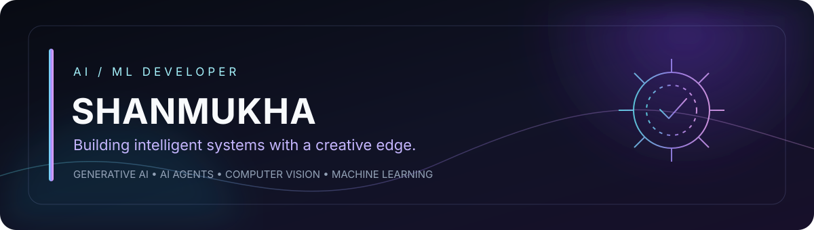

<!-- Midnight Glass profile for editor-shannu -->

  

<table>
  <tr>
    <td width="28%" align="center" valign="middle">
      
    </td>
    <td valign="middle">
      <h2>Hey, I'm Shanmukha Sri Saikumar</h2>
      
<strong>Final-year B.Tech student in Artificial Intelligence & Machine Learning</strong>

      
I build practical AI-powered applications, experiment with intelligent systems, and enjoy turning ideas into useful products.

      

        <a href="https://shannukodz.site">Portfolio</a> ·
        <a href="https://www.linkedin.com/in/shanmukha-sri-saikumar-medisetty">LinkedIn</a> ·
        <a href="https://instagram.com/shannu.ai">Instagram</a> ·
        <a href="https://x.com/shannufx">X</a>
      

    </td>
  </tr>
</table>

---

## What I'm focused on

- Generative AI, LLM applications and AI agents
- Machine learning and computer vision
- Building and deploying real-world AI products
- Exploring developer tools and creative technology

## Tech I work with

**Languages**  

**AI / Data**  

**Tools & platforms**  

---

## Selected projects

| Project | What it does |
|---|---|
| **Alkame** | AI-powered market intelligence and algorithmic signal-generation research platform. |
| **Prescriptime** | Digital prescription and medication-adherence management concept with AI-assisted extraction. |
| **Electricare** | Electricity complaint tracking platform connecting residents and service teams. |
| **Drone AI** | Experiments around AI-powered drone assistance and smart-city applications. |

Explore my repositories for implementation details, demos and updates.

## GitHub activity

  
  

  

---

  

  <strong>Have an interesting idea or collaboration in mind?</strong> 
  Let's connect and build something useful.

  <a href="https://shannukodz.site">Portfolio</a> ·
  <a href="https://www.linkedin.com/in/shanmukha-sri-saikumar-medisetty">LinkedIn</a> ·
  <a href="https://instagram.com/shannu.ai">Instagram</a>

